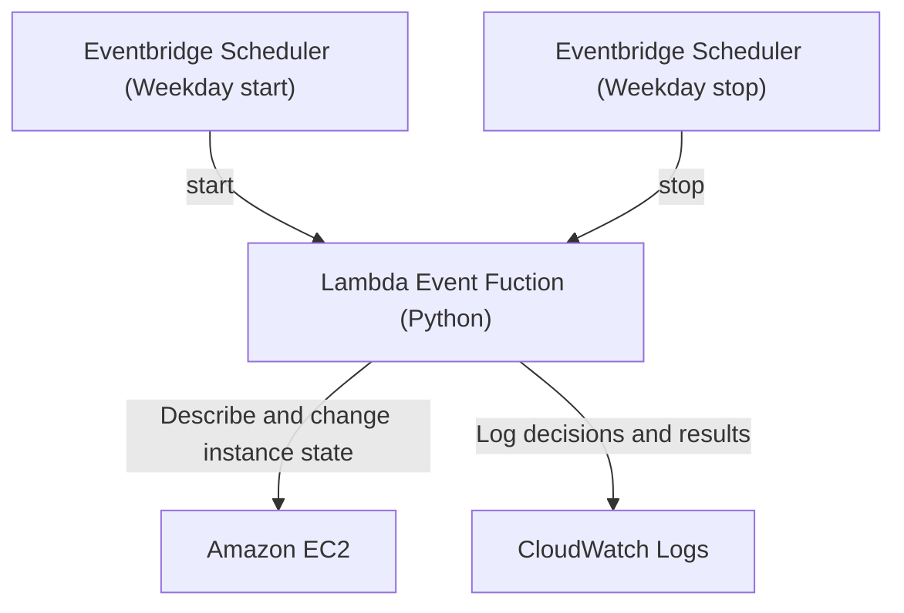

# AWS EC2 Start/Stop Scheduler

Automatically start and stop tagged EC2 instances during Melbourne business hours. The project uses Python and `boto3` for EC2 operations, EventBridge Scheduler for weekday triggers, AWS SAM for infrastructure, and GitHub Actions for deployment.

## What it does
- Deploys infrastructure as code through GitHub Actions using AWS SAM and CloudFormation. SAM packages the Python Lambda, and CloudFormation provisions and updates the Lambda function, IAM roles and policies, EventBridge schedules, and CloudWatch log group.
- Starts matching EC2 instances at morning (**8:00 am**) and stops them at evening (**6:00 pm**), Monday to Friday, using the `Australia/Melbourne` time zone.
- Targets instances tagged `AutoSchedule=office-hours` by default. The desired tag key, tag value, and schedule times are configurable at deployment in environment variables.
- Checks each instance’s current state before acting. Start requests apply to `stopped` instances and stop requests apply to `running` instances.
- Logs accepted requests, skipped instances, failures, and a per-run summary to CloudWatch Logs.

## Architecture



The Scheduler execution role can invoke the Lambda. The Lambda execution role can describe EC2 instances and can start or stop instances in the deployment account and region when they have the configured tag. AWS SAM deploys the resources through CloudFormation.

## Repository structure

```text
.
├── .github/
│   └── workflows/
│       └── deploy.yml
├── app.py
├── template.yaml
└── README.md
```

| File | Purpose |
|---|---|
| `app.py` | Reads the tag configuration, paginates through matching EC2 instances, checks their states, and logs the results of API calls. |
| `template.yaml` | Defines the Lambda, IAM permissions, CloudWatch log group, and EventBridge schedules. |
| `.github/workflows/deploy.yml` | Validates pull requests and deploys the SAM stack on demand from `main`. |

## Prerequisites

- An AWS account and an EBS-backed test EC2 instance in the deployment region. The workflow defaults to `ap-southeast-2` (Sydney).
- An existing S3 bucket in the deployment region for SAM artifacts.
- A GitHub OIDC provider and an AWS deployment role that trusts the repository’s `main` branch. The role needs permissions to deploy the stack and manage its resources, plus access to the artifact bucket.
- Python 3.13 and the AWS SAM CLI for local validation.

## Configuration

Add these repository variables in **Settings → Secrets and variables → Actions → Variables**.

| GitHub Actions variable | Purpose | Example |
|---|---|---|
| `AWS_DEPLOY_ROLE_ARN` | IAM role assumed by the workflow through GitHub OIDC | `arn:aws:iam::123456789012:role/github-ec2-scheduler-deploy` |
| `SAM_ARTIFACT_BUCKET` | S3 bucket for SAM deployment artifacts | `my-sam-artifacts` |
| `EC2_TAG_KEY` | EC2 tag key used to select instances | `AutoSchedule` |
| `EC2_TAG_VALUE` | Required value for the tag | `office-hours` |
| `EC2_START_TIME` | Weekday start time in Melbourne, in `HH:MM` format | `08:00` |
| `EC2_STOP_TIME` | Weekday stop time in Melbourne, in `HH:MM` format | `18:00` |

The workflow passes these settings to SAM. The Lambda receives the tag key and value as environment variables, and EventBridge Scheduler receives the times as weekday cron expressions. Redeploy after changing a repository variable.

## Deploy with GitHub Actions

1. Push the project to `main`.
2. Open **Actions → EC2 Office Hours → Run workflow**.
3. Choose `DISABLED` for the first deployment so you can test the Lambda manually.
4. Run the checks below, then deploy again with `ENABLED` to activate both weekday schedules.

The workflow validates the SAM template, builds the Lambda package, and uses short-lived AWS credentials through GitHub OIDC to deploy the stack.

### Validate locally

Run these commands from the repository root, where `app.py` and `template.yaml` are located.

```bash
python -m py_compile app.py
sam validate --lint --template-file template.yaml --region ap-southeast-2
sam build --template-file template.yaml
test -f .aws-sam/build/OfficeHoursFunction/app.py
```

## Verify the automation

1. Apply the configured tag to a test instance in the same AWS region as the Lambda. Start with the instance in `stopped` state.
2. In the Lambda console, invoke the function with `{"action":"start"}`. Check that CloudWatch Logs records an `accepted` request and EC2 eventually reports `running`.
3. Invoke the same payload again. Check for a `skipped` entry because the instance is already running.
4. Invoke the function with `{"action":"stop"}`. Verify that EC2 eventually reports `stopped`, then repeat the event and check for another `skipped` entry.
5. Enable the schedules through the workflow. In **EventBridge Scheduler**, check the next invocation times and confirm a scheduled invocation in CloudWatch Logs.

The log group is `/aws/lambda/<stack-name>` and retains logs for 14 days. An `accepted` entry means EC2 accepted the API request. Check the EC2 console for the final instance state.

## Troubleshooting

| Symptom | What to check |
|---|---|
| Lambda finds zero matching instances | Check the AWS region and the exact tag key and value configured on the instance. |
| Lambda logs `UnauthorizedOperation` | Check the Lambda execution role’s EC2 permissions and confirm that the instance has the tag required by the IAM policy. |
| Lambda runs manually but never on schedule | Check `ScheduleState`, the next invocation times, and the Scheduler role’s permission to invoke the function. |

## Cleanup

Set `schedule_state` to `DISABLED` and redeploy to pause the automation. To remove the project resources, delete the CloudFormation stack.

```bash
aws cloudformation delete-stack \
  --stack-name <stack_name> \
  --region ap-southeast-2
```

The test EC2 instance and the pre-existing artifact bucket are managed separately. Check the instance’s final state and remove any test resources you no longer need.